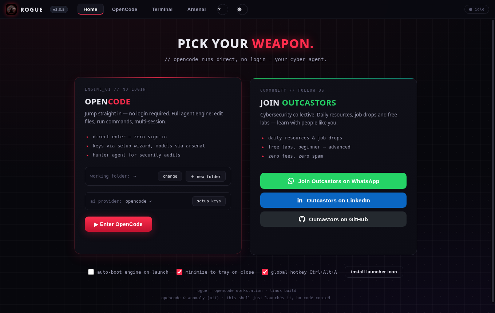
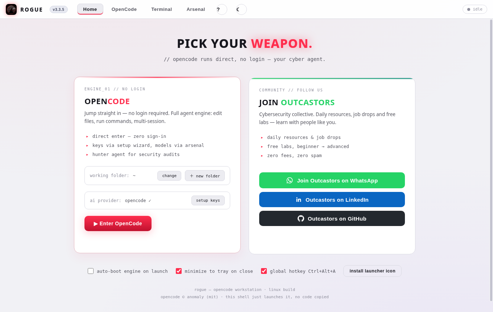
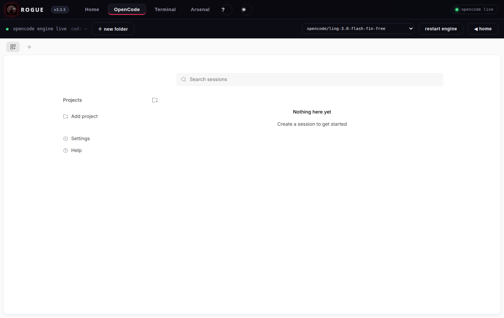
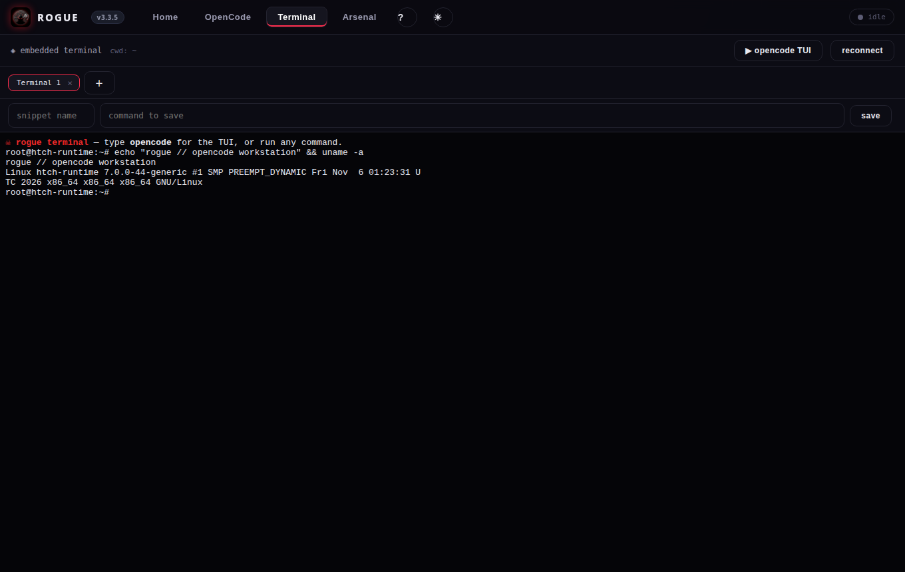
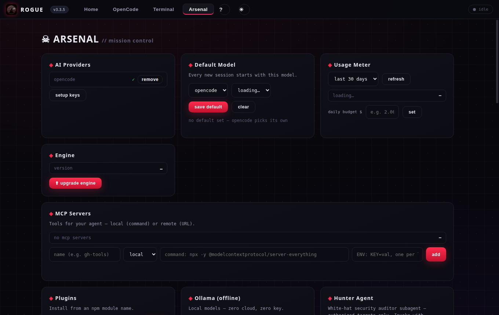
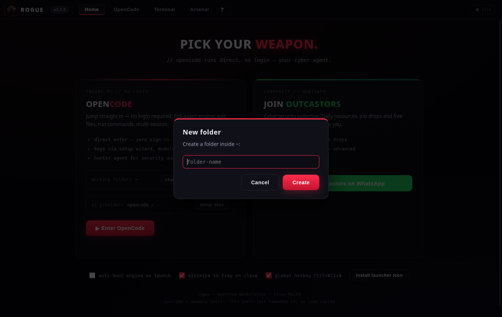

# Rogue — OpenCode workstation for Linux


**Rogue** is a single Linux desktop app that turns [OpenCode](https://github.com/anomalyco/opencode) — the open-source AI coding agent — into a full workstation: direct-enter, no login, your own API keys. Multi-tab terminal, mission-control panel, dark/light themes, and the Outcastors community built in.

> OpenCode © Anomaly (MIT). Rogue is just a shell that launches it — no OpenCode code is copied here.

## Screenshots

### Home — dark theme (blueprint grid) and light theme




### OpenCode, embedded — the agent, inside the app



### Terminal — multi-tab, with saved command snippets



### Arsenal — mission control: providers, models, usage, MCPs, Hunter agent



### New folder — one click, inside the working directory



## Features

- **OpenCode, direct-enter** — the engine boots on its own fixed port and the web UI runs embedded. No account, no sign-in; bring your own keys.
- **19 AI providers** — setup wizard for Groq, OpenAI, Anthropic, Google, DeepSeek, OpenRouter, Ollama (local + Cloud), xAI, Cohere, Together AI, Cerebras, Moonshot, Alibaba, Zhipu GLM, Chutes, Nebius, DeepInfra, and the free `opencode` models. Keys live only in `~/.local/share/opencode/auth.json` (chmod 600) — they never leave your machine.
- **Arsenal (mission control)** — default model picker, usage meter with daily budget alert, engine updater, MCP server manager, plugin installer, Ollama connect, session backup, custom agents, saved command snippets, and the **Hunter agent** — a white-hat security auditor subagent for authorized targets only.
- **Multi-tab terminal** — real bash via node-pty, tabs, snippets, and a one-click `opencode` TUI launcher.
- **Prompt library** — curated cyber prompts, sent straight into your live OpenCode chat.
- **Dark / light themes** — one click in the topbar; the dark theme has a faint blueprint grid. Choice is remembered.
- **New folder** — create folders inside the working directory from the Home tab or the OpenCode toolbar.
- **Self-installing dependencies** — on first run the launcher checks 45 system libraries and installs only the missing ones, so it runs on any Linux.
- **Self-healing engine** — a corrupted session database is backed up (never deleted) and the engine retries automatically.
- **Keyboard shortcuts** — `Ctrl+1…4` switch tabs, `Ctrl+?` cheatsheet, `Ctrl+F4` closes the terminal tab (or the window), `Ctrl+Alt+A` shows/hides the app, `Esc` closes dialogs.

## Download

Latest release — **v3.3.5** ([release page](https://github.com/Outcastors/rogue/releases/tag/v3.3.5)):

- [Rogue-3.3.5-linux-x86_64.AppImage](https://github.com/Outcastors/rogue/releases/download/v3.3.5/Rogue-3.3.5-linux-x86_64.AppImage) — needs FUSE; `chmod +x` and run.
- [Rogue-3.3.5-portable.zip](https://github.com/Outcastors/rogue/releases/download/v3.3.5/Rogue-3.3.5-portable.zip) — extract anywhere and run `Launch-Rogue.sh`. No install, no FUSE, no root.

## Build from source

```bash
git clone https://github.com/Outcastors/rogue.git
cd rogue
npm install        # also regenerates assets/icon.png from scripts/icon.png.b64
npm start          # run from source
npm run dist       # build AppImage + .deb into dist/
```

Requirements: Node.js 20+, Linux x86_64. The OpenCode engine binary downloads itself on first launch (`~/.opencode/bin/`).

## Keyboard shortcuts

| Shortcut | Action |
| --- | --- |
| `Ctrl+1` / `2` / `3` / `4` | Home / OpenCode / Terminal / Arsenal |
| `Ctrl+?` | Keyboard cheatsheet |
| `Ctrl+F4` | Close terminal tab (or close the window) |
| `Ctrl+Alt+A` | Show / hide Rogue |
| `Esc` | Close cheatsheet or dialog |

## Community — Outcastors

Rogue is built by and for the [Outcastors](https://www.linkedin.com/company/outcastors) cybersecurity community — daily resources, job drops and free labs for self-learners.

- 💬 [Join Outcastors on WhatsApp](https://chat.whatsapp.com/ID10GJWOctCKCy5KYn2ZXN?s=cl&p=a&iam=2)
- 💼 [Outcastors on LinkedIn](https://www.linkedin.com/company/outcastors)
- 💻 [Outcastors on GitHub](https://github.com/Outcastors)

## Privacy

Your API keys, sessions and settings stay on your machine (`~/.local/share/opencode/`, `~/.config/Rogue/`). Rogue makes no network calls of its own except the ones you trigger (engine download, provider API calls through OpenCode).

## Credits

- [OpenCode](https://github.com/anomalyco/opencode) by Anomaly — MIT
- [xterm.js](https://github.com/xtermjs/xterm.js) — MIT
- Logo: hooded figure + wolf emblem, generated for Outcastors

## License

MIT — see [LICENSE](LICENSE).
